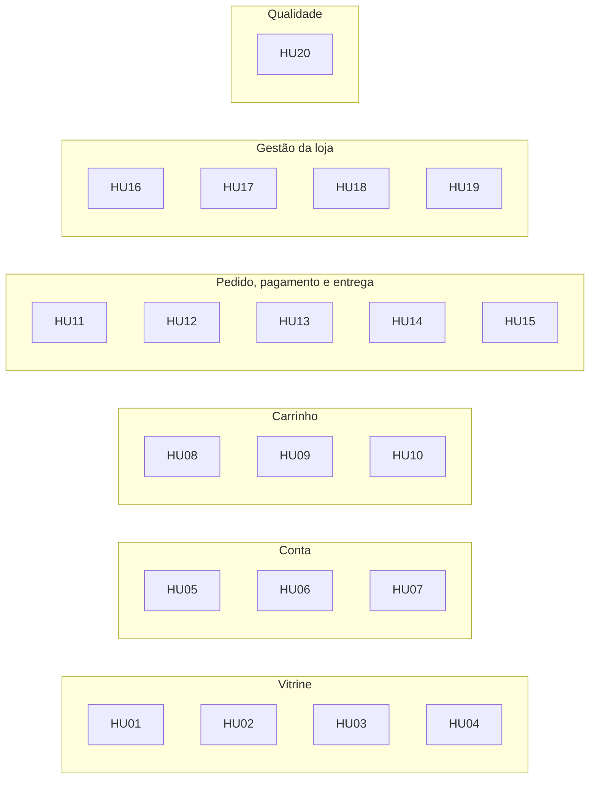

# 2. Histórias de usuário, mapa de afinidade e backlog

Prioridade: **A** (essencial) a **E** (desejável). Pontos de história na escala de Fibonacci (1, 2, 3, 5, 8).

## 2.1 Cartões de história do usuário

### Tema 1: Vitrine

**HU01 · Ver a vitrine**
- **Requerente:** cliente
- **Ação:** Como cliente, quero ver todos os cupcakes disponíveis com foto, nome, descrição e preço para escolher o que comprar.
- **Critérios de aceitação:** CA1 só aparecem cupcakes ativos; CA2 cupcakes sem estoque aparecem com a etiqueta "Esgotado" e sem botão de compra; CA3 os destaques aparecem primeiro.
- **Regras de negócio:** RN01 cupcake fora da vitrine (inativo) não pode ser vendido.
- **Requisito não funcional:** RNF01 a página deve funcionar em telas a partir de 360 px de largura.
- **Prioridade:** A · **Pontos:** 3

**HU02 · Buscar sabor**
- **Requerente:** cliente
- **Ação:** Como cliente, quero buscar pelo nome ou ingrediente para achar meu sabor rapidamente.
- **Critérios de aceitação:** CA1 a busca ignora maiúsculas e minúsculas; CA2 sem resultado, aparece uma mensagem e um botão para ver todos.
- **Prioridade:** B · **Pontos:** 2

**HU03 · Filtrar por categoria**
- **Requerente:** cliente
- **Ação:** Como cliente, quero filtrar por categoria (Clássicos, Frutados, Especiais, Veganos) para ver só o que me interessa.
- **Critérios de aceitação:** CA1 o filtro pode ser combinado com a busca; CA2 há um link para limpar os filtros.
- **Prioridade:** B · **Pontos:** 2

**HU04 · Ver detalhes do cupcake**
- **Requerente:** cliente
- **Ação:** Como cliente, quero abrir um cupcake e ver a descrição completa, o estoque e sugestões parecidas.
- **Critérios de aceitação:** CA1 mostra quantas unidades estão disponíveis; CA2 permite escolher a quantidade; CA3 um endereço inexistente mostra a página 404.
- **Prioridade:** B · **Pontos:** 2

### Tema 2: Conta do cliente

**HU05 · Criar conta**
- **Requerente:** cliente não cadastrado
- **Ação:** Como visitante, quero criar uma conta com nome, e-mail e senha para poder fazer pedidos.
- **Critérios de aceitação:** CA1 o e-mail não pode repetir; CA2 a senha e a confirmação precisam ser iguais; CA3 após o cadastro já fico logado.
- **Regras de negócio:** RN02 a senha tem no mínimo 6 caracteres; RN03 o e-mail é único e salvo em minúsculas.
- **Requisito não funcional:** RNF02 a senha é guardada criptografada (hash PBKDF2), nunca em texto puro.
- **Prioridade:** A · **Pontos:** 3

**HU06 · Entrar**
- **Requerente:** cliente cadastrado
- **Ação:** Como cliente, quero entrar com e-mail e senha para acessar meus pedidos.
- **Critérios de aceitação:** CA1 com dados errados aparece "E-mail ou senha incorretos", sem dizer qual dos dois está errado; CA2 depois do login volto para a página onde estava.
- **Requisito não funcional:** RNF03 o redirecionamento após o login só aceita endereços do próprio site.
- **Prioridade:** A · **Pontos:** 2

**HU07 · Sair**
- **Requerente:** cliente cadastrado
- **Ação:** Como cliente, quero sair da conta para que outra pessoa não use meu login.
- **Prioridade:** A · **Pontos:** 1

### Tema 3: Carrinho

**HU08 · Adicionar ao carrinho**
- **Requerente:** cliente
- **Ação:** Como cliente, quero adicionar cupcakes ao carrinho mesmo sem estar logado.
- **Critérios de aceitação:** CA1 o contador do carrinho no topo atualiza; CA2 adicionar o mesmo sabor soma a quantidade.
- **Regras de negócio:** RN04 não é possível adicionar mais do que o estoque; RN05 máximo de 20 unidades por sabor em cada pedido.
- **Prioridade:** A · **Pontos:** 3

**HU09 · Alterar o carrinho**
- **Requerente:** cliente
- **Ação:** Como cliente, quero mudar a quantidade ou remover itens.
- **Critérios de aceitação:** CA1 quantidade 0 remove o item; CA2 subtotal, frete e total são recalculados.
- **Prioridade:** A · **Pontos:** 2

**HU10 · Ver quanto falta para o frete grátis**
- **Requerente:** cliente
- **Ação:** Como cliente, quero saber quanto falta para ganhar frete grátis.
- **Regras de negócio:** RN06 frete de R$ 7,00, grátis a partir de R$ 80,00; retirada na loja não paga frete.
- **Prioridade:** C · **Pontos:** 1

### Tema 4: Pedido, pagamento e entrega

**HU11 · Escolher entrega ou retirada**
- **Requerente:** cliente
- **Ação:** Como cliente, quero escolher entre receber em casa ou retirar na loja.
- **Critérios de aceitação:** CA1 o endereço só é pedido para entrega; CA2 o total muda na hora ao trocar a opção.
- **Regras de negócio:** RN07 o endereço exige rua, número, bairro, cidade e CEP de 8 dígitos.
- **Prioridade:** A · **Pontos:** 3

**HU12 · Pagar o pedido**
- **Requerente:** cliente
- **Ação:** Como cliente, quero pagar por Pix, cartão de crédito ou dinheiro na entrega.
- **Critérios de aceitação:** CA1 Pix é aprovado na hora e gera um código; CA2 cartão inválido ou vencido é recusado com o motivo; CA3 dinheiro fica pendente até a entrega.
- **Regras de negócio:** RN08 o cartão passa pela validação de Luhn, validade MM/AA não vencida e CVV de 3 ou 4 dígitos; RN09 só os 4 últimos dígitos do cartão são guardados.
- **Requisito não funcional:** RNF04 pagamento simulado, com aviso visível de ambiente de demonstração.
- **Prioridade:** A · **Pontos:** 5

**HU13 · Confirmar o pedido**
- **Requerente:** cliente
- **Ação:** Como cliente, quero confirmar o pedido e receber o número dele.
- **Critérios de aceitação:** CA1 o estoque é baixado; CA2 o carrinho é esvaziado; CA3 se o estoque acabou durante a compra, aparece quais itens ajustar e nada é cobrado.
- **Regras de negócio:** RN10 o preço gravado no item é o do momento da compra.
- **Prioridade:** A · **Pontos:** 5

**HU14 · Acompanhar o pedido**
- **Requerente:** cliente
- **Ação:** Como cliente, quero ver meus pedidos e o andamento de cada um (recebido, em preparo, saiu para entrega, entregue).
- **Critérios de aceitação:** CA1 a linha do tempo destaca a etapa atual; CA2 um cliente não consegue ver o pedido de outro.
- **Prioridade:** A · **Pontos:** 3

**HU15 · Cancelar o pedido**
- **Requerente:** cliente
- **Ação:** Como cliente, quero cancelar um pedido que acabei de fazer.
- **Regras de negócio:** RN11 o cliente só cancela enquanto o status for "Recebido"; RN12 ao cancelar, o estoque volta e o pagamento aprovado é estornado.
- **Prioridade:** B · **Pontos:** 2

### Tema 5: Gestão da loja (administrador)

**HU16 · Ver os pedidos da loja**
- **Requerente:** administrador
- **Ação:** Como atendente, quero ver todos os pedidos com cliente, itens, entrega e pagamento, filtrando por status.
- **Requisito não funcional:** RNF05 só administradores acessam o painel (os demais recebem 403).
- **Prioridade:** A · **Pontos:** 3

**HU17 · Avançar o status do pedido**
- **Requerente:** administrador
- **Ação:** Como confeiteiro, quero avançar o pedido para a próxima etapa.
- **Regras de negócio:** RN13 fluxo de entrega: recebido → em preparo → saiu para entrega → entregue; fluxo de retirada: recebido → em preparo → pronto para retirada → entregue; RN14 pagamento em dinheiro é marcado como aprovado na entrega.
- **Prioridade:** A · **Pontos:** 3

**HU18 · Cadastrar e editar cupcakes**
- **Requerente:** administrador
- **Ação:** Como dono, quero cadastrar sabores novos e editar preço, estoque, categoria e cor.
- **Critérios de aceitação:** CA1 aceita preço com vírgula; CA2 mostra todos os erros do formulário de uma vez; CA3 há uma prévia da cor da cobertura.
- **Prioridade:** A · **Pontos:** 5

**HU19 · Tirar da vitrine**
- **Requerente:** administrador
- **Ação:** Como dono, quero tirar um sabor da vitrine sem apagá-lo, para não perder o histórico dos pedidos.
- **Prioridade:** B · **Pontos:** 1

### Tema 6: Qualidade (testes com usuários)

**HU20 · Avaliar o sistema**
- **Requerente:** testador
- **Ação:** Como colega testador, quero um formulário para registrar o que funcionou, o que não funcionou, o que não testei, sugestões e o link dos prints.
- **Prioridade:** B · **Pontos:** 2

## 2.2 Mapa de afinidade

## 2.3 Backlog do produto priorizado

| Ordem | ID | História | Tema | Pontos | Prioridade |
|---|---|---|---|---|---|
| 1 | HU01 | Ver a vitrine | Vitrine | 3 | A |
| 2 | HU08 | Adicionar ao carrinho | Carrinho | 3 | A |
| 3 | HU09 | Alterar o carrinho | Carrinho | 2 | A |
| 4 | HU05 | Criar conta | Conta | 3 | A |
| 5 | HU06 | Entrar | Conta | 2 | A |
| 6 | HU07 | Sair | Conta | 1 | A |
| 7 | HU11 | Escolher entrega ou retirada | Pedido | 3 | A |
| 8 | HU12 | Pagar o pedido | Pedido | 5 | A |
| 9 | HU13 | Confirmar o pedido | Pedido | 5 | A |
| 10 | HU14 | Acompanhar o pedido | Pedido | 3 | A |
| 11 | HU16 | Ver os pedidos da loja | Gestão | 3 | A |
| 12 | HU17 | Avançar o status | Gestão | 3 | A |
| 13 | HU18 | Cadastrar e editar cupcakes | Gestão | 5 | A |
| 14 | HU04 | Ver detalhes do cupcake | Vitrine | 2 | B |
| 15 | HU02 | Buscar sabor | Vitrine | 2 | B |
| 16 | HU03 | Filtrar por categoria | Vitrine | 2 | B |
| 17 | HU15 | Cancelar o pedido | Pedido | 2 | B |
| 18 | HU19 | Tirar da vitrine | Gestão | 1 | B |
| 19 | HU20 | Avaliar o sistema | Qualidade | 2 | B |
| 20 | HU10 | Quanto falta para o frete grátis | Carrinho | 1 | C |
| | | **Total** | | **53** | |

## 2.4 Tarefas (estimadas entre 2 e 12 horas)

| Sprint | Tarefa | Histórias | Horas |
|---|---|---|---|
| 1 | Criar o projeto Flask em MVC, configurações e conexão com o banco | todas | 3 |
| 1 | Criar os modelos Categoria e Cupcake e o script de dados iniciais | HU01, HU18 | 3 |
| 1 | Montar o layout base (cabeçalho, mensagens, rodapé) e o CSS responsivo | HU01 | 4 |
| 1 | Tela da vitrine com busca e filtro | HU01, HU02, HU03 | 3 |
| 1 | Tela de detalhes do cupcake | HU04 | 2 |
| 2 | Modelo Cliente com hash de senha; telas de cadastro, login e logout | HU05, HU06, HU07 | 4 |
| 2 | Serviço do carrinho em sessão com as regras de estoque e limite | HU08, HU09 | 3 |
| 2 | Tela do carrinho com cálculo de frete | HU09, HU10 | 2 |
| 3 | Modelos Pedido, ItemPedido e Pagamento | HU13 | 3 |
| 3 | Serviço de pagamento simulado (Pix, cartão com Luhn, dinheiro) | HU12 | 3 |
| 3 | Serviço de criação do pedido com baixa de estoque e transação | HU11, HU13 | 4 |
| 3 | Tela de finalização com JavaScript para endereço e cartão | HU11, HU12 | 3 |
| 3 | Telas "Meus pedidos" e acompanhamento com linha do tempo, e cancelamento | HU14, HU15 | 3 |
| 4 | Painel de pedidos com filtro e avanço de status | HU16, HU17 | 3 |
| 4 | CRUD de cupcakes com prévia da cor e opção de tirar da vitrine | HU18, HU19 | 4 |
| 4 | Proteção CSRF, páginas de erro 400/403/404/500 | todas | 2 |
| 4 | Formulário de avaliação e listagem no painel | HU20 | 2 |
| 5 | Testes unitários e de rotas com Pytest | todas | 6 |
| 5 | Banco no Supabase e publicação na Vercel | todas | 2 |
| 5 | Documentação, manual e vídeo | todas | 6 |
| | **Total** | | **65** |
