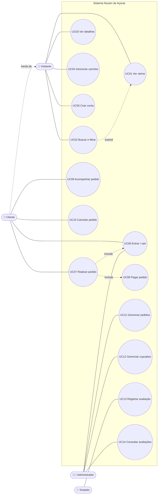
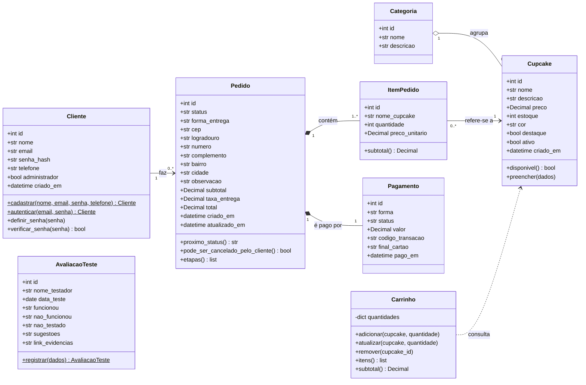
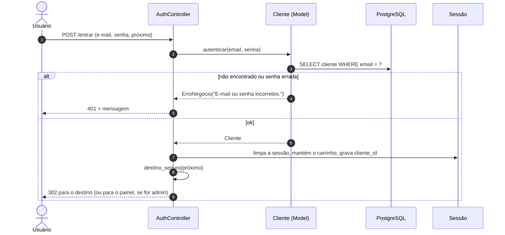
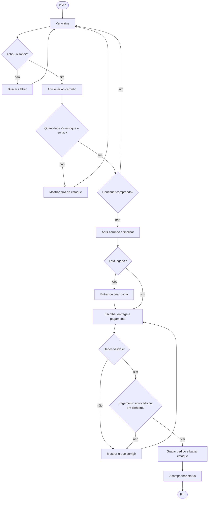
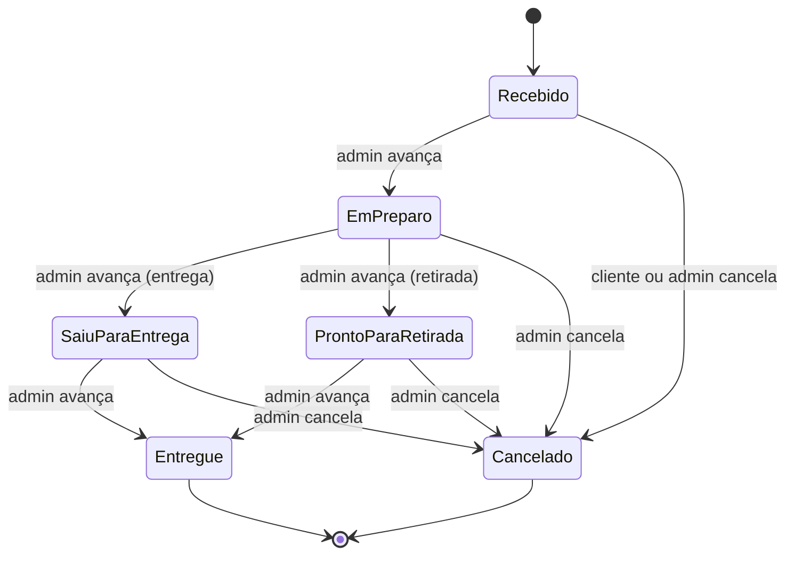

# 3. Modelagem UML

Os diagramas estão em Mermaid, que o GitHub desenha automaticamente ao abrir este arquivo.

## 3.1 Diagrama de casos de uso geral



O **Cliente** é um visitante que tem conta, por isso pode fazer tudo o que o visitante faz. O **Administrador** também é um cliente, com acesso extra ao painel.

## 3.2 Casos de uso expandidos

### UC07 · Realizar pedido

- **Identificador:** UC07
- **Ator principal:** Cliente
- **Descrição:** o cliente transforma o carrinho em um pedido, escolhendo entrega e pagamento.
- **Pré-condições:** o carrinho tem pelo menos um item; o cliente está logado (senão, UC06 é executado antes).
- **Pós-condições:** o pedido fica com status "Recebido", o estoque é baixado, o pagamento é registrado e o carrinho é esvaziado.

**Curso básico:**
1. O caso de uso começa quando o cliente clica em "Finalizar pedido" na TELA03 (Carrinho).
2. O sistema verifica se o cliente está logado. <Alternativo A>
3. O sistema exibe a TELA05 (Finalizar pedido), com o resumo dos itens, o subtotal e o frete calculado pela RN06.
4. O cliente escolhe "Entrega em casa". <Alternativo B>
5. O cliente preenche o endereço.
6. O cliente escolhe a forma de pagamento (UC08).
7. O cliente clica em "Confirmar pedido".
8. O sistema valida o endereço pela RN07. <Alternativo C>
9. O sistema bloqueia as linhas dos cupcakes e confere o estoque de cada item. <Alternativo D>
10. O sistema processa o pagamento (UC08). <Alternativo E>
11. O sistema grava o pedido, os itens (com o preço do momento, RN10) e o pagamento, e baixa o estoque, tudo em uma única transação.
12. O sistema esvazia o carrinho.
13. O sistema exibe a TELA06 (Acompanhamento) com a mensagem "Pedido #N confirmado!".
14. O caso de uso termina.

**Curso alternativo A, cliente não logado:**
A2. O sistema mostra "Entre na sua conta para continuar" e exibe a TELA04 (Entrar). A3. Depois do login, o sistema volta para o passo 3. O carrinho é mantido.

**Curso alternativo B, retirada na loja:**
B4. O cliente escolhe "Retirar na loja". B5. O sistema esconde o endereço e zera o frete. Continua no passo 6.

**Curso alternativo C, endereço incompleto:**
C8. O sistema mostra quais campos faltam e se o CEP é inválido, mantendo o que foi digitado. Volta ao passo 5.

**Curso alternativo D, estoque insuficiente:**
D9. O sistema desfaz a transação e mostra "O estoque mudou enquanto você comprava. Ajuste estes itens: ...". Nada é cobrado. O caso de uso termina.

**Curso alternativo E, pagamento recusado:**
E10. O sistema desfaz a transação e mostra "Pagamento recusado:" seguido do motivo. O estoque não é alterado. Volta ao passo 6.

### UC08 · Pagar pedido

- **Ator principal:** Cliente
- **Pré-condições:** UC07 em andamento.
- **Pós-condições:** um registro de pagamento é criado com o status correto.

**Curso básico (Pix):**
1. O cliente escolhe Pix.
2. O sistema aprova o pagamento, gera um código PIX-XXXXXXXXXXXX e registra a data.
3. O caso de uso retorna ao UC07.

**Curso alternativo, cartão de crédito:**
1. O cliente escolhe cartão e informa titular, número, validade e CVV.
2. O sistema valida o número pelo algoritmo de Luhn, a validade (MM/AA, não vencida) e o CVV (RN08).
3. Se tudo estiver certo, o pagamento é aprovado e só os 4 últimos dígitos são guardados (RN09). Senão, o sistema lança "Pagamento recusado" com a lista de problemas.

**Curso alternativo, dinheiro na entrega:**
1. O cliente escolhe dinheiro. 2. O pagamento fica "Pendente" e será aprovado quando o pedido for marcado como entregue (RN14).

### UC05 · Criar conta

- **Ator principal:** Visitante
- **Pré-condições:** nenhuma.
- **Pós-condições:** o cliente é cadastrado e já fica logado.

**Curso básico:**
1. O visitante clica em "Cadastre-se" na TELA04.
2. O sistema exibe a TELA04b (Criar conta).
3. O visitante informa nome, e-mail, telefone (opcional), senha e confirmação.
4. O sistema confere se a senha e a confirmação são iguais. <Alternativo A>
5. O sistema valida os campos pelas RN02 e RN03. <Alternativo B>
6. O sistema grava o cliente com a senha criptografada.
7. O sistema inicia a sessão, mantendo o carrinho, e mostra "Conta criada! Bem-vindo(a)".

**Alternativo A:** A4. Mostra "As senhas digitadas não são iguais." Volta ao passo 3.
**Alternativo B:** B5. Mostra todos os problemas de uma vez (nome curto, e-mail inválido, senha curta ou e-mail já cadastrado). Volta ao passo 3.

### UC11 · Gerenciar pedidos

- **Ator principal:** Administrador
- **Pré-condições:** o usuário está logado com uma conta de administrador. <Alternativo A>
- **Pós-condições:** o status do pedido é atualizado.

**Curso básico:**
1. O administrador abre a TELA07 (Painel · Pedidos).
2. O sistema lista os pedidos do mais novo para o mais antigo, com o número de pedidos em aberto.
3. O administrador filtra por status (opcional).
4. O administrador clica em "Avançar" em um pedido.
5. O sistema muda o status para a próxima etapa do fluxo (RN13). Se a etapa for "Entregue" e o pagamento estiver pendente, ele é aprovado (RN14).
6. O sistema mostra "Pedido #N agora está: ...".

**Alternativo A, usuário sem permissão:** o sistema exibe a página 403 "Acesso negado".
**Alternativo B, cancelar:** B4. O administrador clica em "Cancelar" e confirma. B5. O sistema cancela o pedido em qualquer etapa não finalizada, devolve o estoque e estorna o pagamento aprovado (RN12).

### UC12 · Gerenciar cupcakes

- **Ator principal:** Administrador
- **Pós-condições:** o cupcake é criado ou atualizado.

**Curso básico:**
1. O administrador abre a TELA08 (Painel · Cupcakes) e clica em "Cadastrar cupcake" ou "Editar".
2. O sistema exibe a TELA09 com a prévia da cobertura.
3. O administrador informa nome, descrição, preço, estoque, categoria, cor e destaque.
4. O sistema valida tudo (nome com 3 letras ou mais, preço maior que zero, estoque inteiro e não negativo, cor hexadecimal, categoria). <Alternativo A>
5. O sistema salva e mostra "Nome foi salvo."

**Alternativo A:** A4. O sistema mostra todos os erros de uma vez e mantém os dados digitados.
**Alternativo B, tirar da vitrine:** o administrador clica em "Tirar da vitrine". O cupcake fica inativo, some da vitrine e dos carrinhos, mas continua nos pedidos antigos.

## 3.3 Diagrama de classes (persistência)



- **Agregação** Categoria–Cupcake: o cupcake existe sem a categoria e pode mudar de categoria.
- **Composição** Pedido–ItemPedido e Pedido–Pagamento: itens e pagamento não existem sem o pedido. No banco, isso é `ON DELETE CASCADE`.
- **Carrinho** não é persistido no banco. Ele vive na sessão do navegador (cookie assinado), por isso aparece como dependência.

## 3.4 Diagrama de sequência: realizar pedido

```mermaid
sequenceDiagram
  autonumber
  actor C as Cliente
  participant V as View (finalizar.html)
  participant PC as PedidosController
  participant CS as Carrinho
  participant PS as Serviço de pedidos
  participant PG as Serviço de pagamentos
  participant DB as PostgreSQL

  C->>V: Preenche entrega e pagamento e clica em Confirmar
  V->>PC: POST /pedidos/finalizar (com token CSRF)
  PC->>PC: verificar_csrf() e login_obrigatorio
  PC->>CS: obter_carrinho() da sessão
  PC->>PS: criar_pedido(cliente, carrinho, ...)
  PS->>CS: itens()
  CS->>DB: SELECT cupcakes do carrinho
  alt entrega em casa
    PS->>PS: validar_endereco()
  end
  loop para cada item
    PS->>DB: SELECT ... FOR UPDATE (trava o cupcake)
  end
  alt estoque insuficiente
    PS->>DB: ROLLBACK
    PS-->>PC: ErroNegocio("O estoque mudou...")
    PC-->>V: 422 + mensagem de erro
  else estoque ok
    PS->>PS: calcular_taxa_entrega()
    PS->>PG: processar_pagamento(forma, total, cartão)
    alt pagamento recusado
      PG-->>PS: ErroNegocio("Pagamento recusado: ...")
      PS->>DB: ROLLBACK
      PC-->>V: 422 + motivo da recusa
    else aprovado ou pendente
      PG-->>PS: Pagamento
      PS->>DB: INSERT pedido, itens, pagamento; UPDATE estoque
      PS->>DB: COMMIT
      PS->>CS: limpar()
      PS-->>PC: Pedido
      PC-->>C: 302 para /pedidos/N com "Pedido #N confirmado!"
    end
  end
```

## 3.5 Diagrama de sequência: entrar na conta



## 3.6 Diagrama de atividades: compra



## 3.7 Diagrama de estados do pedido


