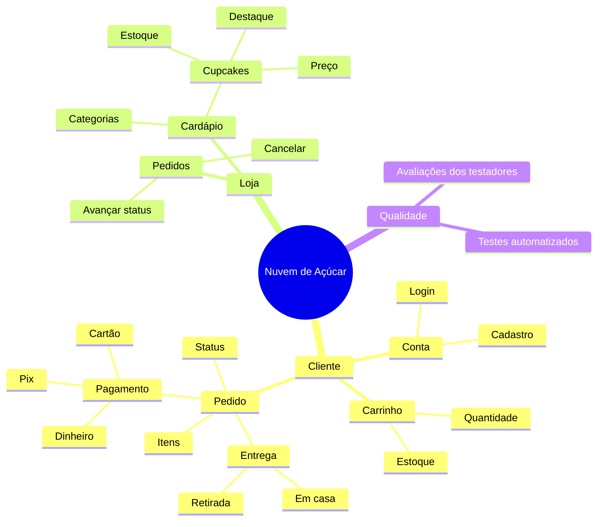
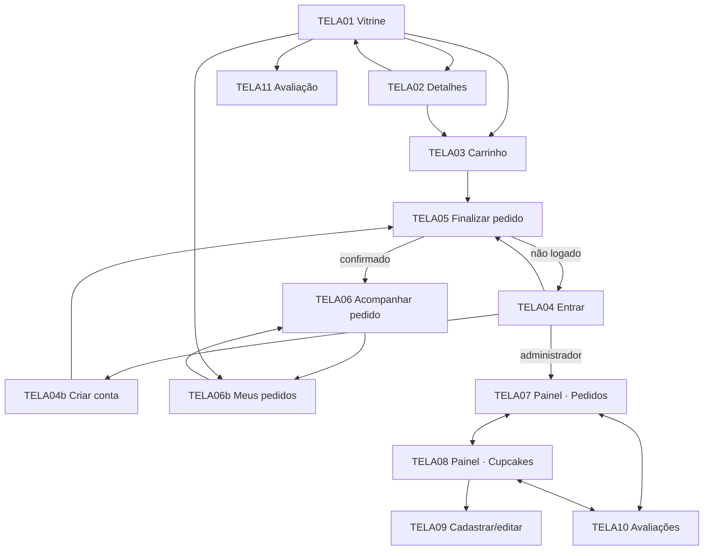

# 4. Interface (IHC)

O PIT I entregou wireframes de baixa fidelidade de login, catálogo, carrinho e perfil. Aqui eles evoluíram para telas funcionais, e foram incluídas as telas que faltavam para cobrir pedido, pagamento, entrega e gestão.

## 4.1 Princípios aplicados

| Princípio | Como aparece no sistema |
|---|---|
| Clareza | Preço final, frete e total sempre visíveis no resumo do carrinho e da finalização |
| Consistência | Mesmo cabeçalho, mesmos botões e as mesmas cores de status em todas as telas |
| Simplicidade | A finalização cabe em uma página só, com 3 blocos numerados; o endereço e o cartão só aparecem quando necessários |
| Controle do usuário | É possível alterar o carrinho, cancelar um pedido recém-feito e fechar qualquer aviso |
| Feedback | Toda ação mostra uma mensagem verde (sucesso), vermelha (erro) ou amarela (aviso) |
| Recuperação de erros | Formulários com erro mantêm o que foi digitado e listam tudo o que precisa ser corrigido de uma vez |
| Acessibilidade | Link "Pular para o conteúdo", rótulos em todos os campos, foco visível, `aria-live` nas mensagens, contraste alto |
| Responsividade | Layout em grade que vira uma coluna no celular, com menu recolhível |

## 4.2 Inventário de telas

| Código | Tela | Endereço | Captura |
|---|---|---|---|
| TELA01 | Vitrine | `/` | [01-vitrine.jpg](../telas/01-vitrine.jpg) |
| TELA02 | Detalhes do cupcake | `/cupcake/<id>` | [02-detalhe-cupcake.jpg](../telas/02-detalhe-cupcake.jpg) |
| TELA03 | Carrinho | `/carrinho/` | [03-carrinho.jpg](../telas/03-carrinho.jpg) |
| TELA04 | Entrar | `/entrar` | [04-login.jpg](../telas/04-login.jpg) |
| TELA04b | Criar conta | `/cadastro` | |
| TELA05 | Finalizar pedido | `/pedidos/finalizar` | [05-finalizar-erro-endereco.jpg](../telas/05-finalizar-erro-endereco.jpg) |
| TELA06 | Acompanhar pedido | `/pedidos/<id>` | [06-pedido-acompanhamento.jpg](../telas/06-pedido-acompanhamento.jpg) |
| TELA06b | Meus pedidos | `/pedidos/` | |
| TELA07 | Painel · Pedidos | `/admin/` | [07-admin-pedidos.jpg](../telas/07-admin-pedidos.jpg) |
| TELA08 | Painel · Cupcakes | `/admin/cupcakes` | [08-admin-cupcakes.jpg](../telas/08-admin-cupcakes.jpg) |
| TELA09 | Cadastrar / editar cupcake | `/admin/cupcakes/novo` | [09-admin-editar-cupcake.jpg](../telas/09-admin-editar-cupcake.jpg) |
| TELA10 | Painel · Avaliações de teste | `/admin/avaliacoes` | |
| TELA11 | Formulário de avaliação | `/avaliacao/` | [10-formulario-avaliacao.jpg](../telas/10-formulario-avaliacao.jpg) |
| TELA12 | Páginas de erro 400/403/404/500 | qualquer | [11-erro-404.jpg](../telas/11-erro-404.jpg) |
| | Vitrine no celular | `/` | [12-vitrine-celular.jpg](../telas/12-vitrine-celular.jpg) |

## 4.3 Mensagens do sistema

| Situação | Tipo | Mensagem |
|---|---|---|
| Item adicionado | Sucesso | "Chocolate Belga foi adicionado ao carrinho." |
| Acima do estoque | Erro | "Só temos 5 unidade(s) de Chocolate Belga em estoque." |
| Acima do limite | Erro | "O limite é de 20 unidades por sabor em cada pedido." |
| Sabor esgotado | Erro | "Coco e Banana Vegano está esgotado no momento." |
| Finalizar sem login | Aviso | "Entre na sua conta para continuar." |
| Login inválido | Erro | "E-mail ou senha incorretos." |
| E-mail já usado | Erro | "Já existe uma conta com este e-mail. Tente entrar." |
| Senhas diferentes | Erro | "As senhas digitadas não são iguais." |
| Endereço incompleto | Erro | "Preencha o endereço: rua, número. O CEP precisa ter 8 números." |
| Cartão inválido | Erro | "Pagamento recusado: o número do cartão é inválido; ..." |
| Estoque mudou | Erro | "O estoque mudou enquanto você comprava. Ajuste estes itens: ..." |
| Pedido feito | Sucesso | "Pedido #12 confirmado! Acompanhe o status por aqui." |
| Cancelar em preparo | Erro | "O pedido já está em preparo. Fale com a loja para cancelar." |
| Página inexistente | Página 404 | "O endereço não existe ou o cupcake saiu da vitrine." |
| Área de admin | Página 403 | "Esta área é só para administradores da loja." |
| Formulário expirado | Página 400 | "O formulário expirou ou veio incompleto..." |

## 4.4 Mapa conceitual

## 4.5 Mapa navegacional

## 4.6 Paleta e tipografia

| Elemento | Valor |
|---|---|
| Fundo | creme `#fff8f1` |
| Texto | cacau `#3b2418` |
| Ação principal | rosa `#d94f7c` |
| Sucesso | menta `#2f8f6b` |
| Aviso | mel `#b7791f` |
| Erro | `#c0392b` |
| Títulos | Fraunces (serifada) |
| Texto | Nunito (sem serifa) |
