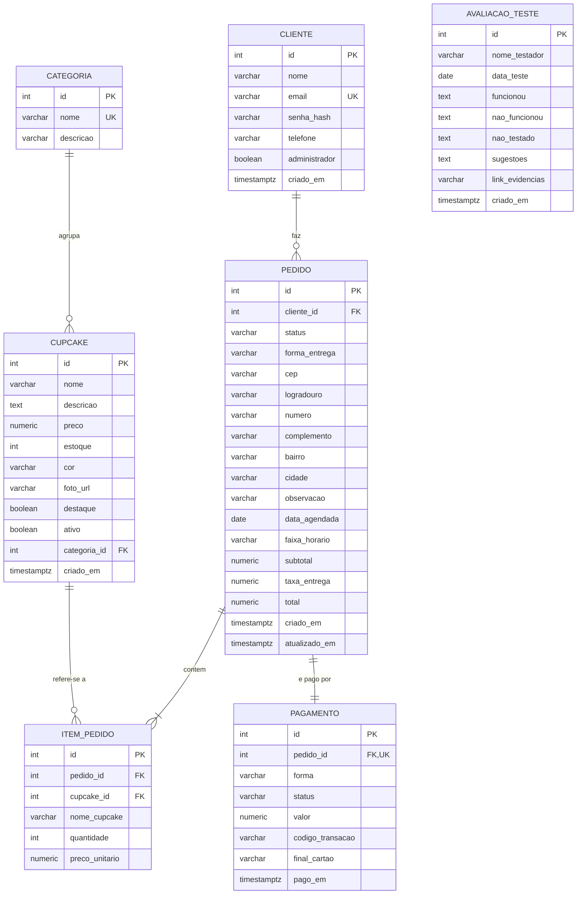

# 5. Projeto do banco de dados

**SGBD:** PostgreSQL 17, hospedado no Supabase (região São Paulo). Nos testes automatizados e no desenvolvimento local, o mesmo modelo roda em SQLite pelo SQLAlchemy.

## 5.1 Projeto conceitual

| Entidade | Descrição |
|---|---|
| Categoria | Agrupamento dos sabores na vitrine |
| Cupcake | Produto vendido |
| Cliente | Pessoa com conta; também representa o administrador |
| Pedido | Compra feita por um cliente |
| Item do pedido | Cada sabor e quantidade dentro de um pedido |
| Pagamento | Forma, situação e comprovante do pagamento de um pedido |
| Avaliação de teste | Retorno dos colegas que testaram o sistema |

Relacionamentos:
- Uma categoria **agrupa** zero ou mais cupcakes; cada cupcake pertence a exatamente uma categoria (1:N).
- Um cliente **faz** zero ou mais pedidos; cada pedido é de um cliente (1:N).
- Um pedido **contém** um ou mais itens; cada item é de um pedido (1:N). Cada item **refere-se a** um cupcake (N:1). Pedido e Cupcake formam, assim, um N:N resolvido pela entidade associativa Item do pedido.
- Um pedido **é pago por** exatamente um pagamento (1:1).

## 5.2 Projeto lógico (normalizado)

**Normalização**

- **1FN:** todos os atributos são atômicos. O endereço foi dividido em CEP, rua, número, complemento, bairro e cidade, e não há listas dentro de uma coluna (os itens do pedido estão em uma tabela própria).
- **2FN:** todas as tabelas têm chave primária simples (`id`), então não existe dependência parcial.
- **3FN:** não há dependência transitiva. O nome da categoria fica só em `categoria`; o cupcake guarda apenas `categoria_id`.

**Desnormalizações intencionais (registro histórico)**

- `item_pedido.preco_unitario` e `item_pedido.nome_cupcake` copiam o preço e o nome do momento da compra. Se o lojista mudar o preço ou o nome depois, os pedidos antigos continuam corretos (RN10).
- `pedido.subtotal`, `taxa_entrega` e `total` são gravados porque a regra de frete pode mudar no futuro.
- O endereço fica no pedido (e não no cliente), porque cada pedido pode ir para um lugar diferente.

## 5.3 Projeto físico

O script completo está em [`database/schema.sql`](../../database/schema.sql) e os dados iniciais em [`database/seed.sql`](../../database/seed.sql). Os dois foram gerados a partir dos modelos do SQLAlchemy, o que garante que o código e o banco usam exatamente a mesma estrutura.

Restrições implementadas no banco:

| Tabela | Restrição |
|---|---|
| cupcake | `CHECK (preco > 0)`, `CHECK (estoque >= 0)`, FK para categoria, índice em `categoria_id` |
| cliente | `UNIQUE (email)` |
| pedido | `CHECK forma_entrega in ('entrega','retirada')`, `CHECK status in (...)`, `CHECK (total >= 0)`, índices em `cliente_id` e `status` |
| item_pedido | `CHECK (quantidade > 0)`, `CHECK (preco_unitario > 0)`, FK para pedido com `ON DELETE CASCADE`, índices em `pedido_id` e `cupcake_id` |
| pagamento | `CHECK forma in (...)`, `CHECK status in (...)`, `UNIQUE (pedido_id)` (garante o 1:1), FK com `ON DELETE CASCADE` |
| todas | `ROW LEVEL SECURITY` ligado e sem políticas: a API pública do Supabase não lê nem grava nada; só o back-end, conectado diretamente ao PostgreSQL, acessa os dados |

## 5.4 Dicionário de dados

### categoria

| Coluna | Tipo | Nulo | Chave | Descrição | Domínio |
|---|---|---|---|---|---|
| id | serial | não | PK | Identificador | inteiro > 0 |
| nome | varchar(60) | não | UK | Nome exibido no filtro | único |
| descricao | varchar(255) | não | | Texto explicativo | pode ser vazio |

### cupcake

| Coluna | Tipo | Nulo | Chave | Descrição | Domínio |
|---|---|---|---|---|---|
| id | serial | não | PK | Identificador | inteiro > 0 |
| nome | varchar(80) | não | | Nome do sabor | 3 a 80 caracteres |
| descricao | text | não | | Ingredientes e detalhes | livre |
| preco | numeric(8,2) | não | | Preço unitário em reais | > 0 |
| estoque | integer | não | | Unidades disponíveis hoje | >= 0 |
| cor | varchar(7) | não | | Cor da cobertura na ilustração | `#RRGGBB` |
| foto_url | varchar(500) | sim | | Link da foto do cupcake; sem foto, a vitrine mostra a ilustração (laudo S02) | começa com `https://` |
| destaque | boolean | não | | Mostra a etiqueta "Mais pedido" e aparece primeiro | true/false |
| ativo | boolean | não | | Se está na vitrine | true/false |
| categoria_id | integer | não | FK → categoria.id | Categoria do sabor | categoria existente |
| criado_em | timestamptz | não | | Data do cadastro | |

### cliente

| Coluna | Tipo | Nulo | Chave | Descrição | Domínio |
|---|---|---|---|---|---|
| id | serial | não | PK | Identificador | inteiro > 0 |
| nome | varchar(100) | não | | Nome completo | 3 caracteres ou mais |
| email | varchar(120) | não | UK | Login, em minúsculas | e-mail válido, único |
| senha_hash | varchar(255) | não | | Hash PBKDF2-SHA256 com 600.000 iterações e sal | nunca a senha em si |
| telefone | varchar(20) | não | | Contato | pode ser vazio |
| administrador | boolean | não | | Acesso ao painel | true/false |
| criado_em | timestamptz | não | | Data do cadastro | |

### pedido

| Coluna | Tipo | Nulo | Chave | Descrição | Domínio |
|---|---|---|---|---|---|
| id | serial | não | PK | Número do pedido | inteiro > 0 |
| cliente_id | integer | não | FK → cliente.id | Quem comprou | cliente existente |
| status | varchar(25) | não | | Etapa atual | recebido, em_preparo, saiu_para_entrega, pronto_para_retirada, entregue, cancelado |
| forma_entrega | varchar(10) | não | | Como recebe | entrega, retirada |
| cep | varchar(8) | sim | | CEP só com números | 8 dígitos (se entrega) |
| logradouro | varchar(120) | sim | | Rua | obrigatório se entrega |
| numero | varchar(10) | sim | | Número | obrigatório se entrega |
| complemento | varchar(60) | sim | | Apto, bloco... | opcional |
| bairro | varchar(60) | sim | | Bairro | obrigatório se entrega |
| cidade | varchar(60) | sim | | Cidade | obrigatório se entrega |
| observacao | varchar(255) | não | | Recado do cliente | pode ser vazio |
| data_agendada | date | sim | | Dia escolhido para a entrega ou retirada; vazio = "o quanto antes" (laudo B02) | de amanhã até 7 dias |
| faixa_horario | varchar(20) | sim | | Horário escolhido junto com o dia (laudo B02) | 09h às 12h, 12h às 15h, 15h às 18h ou 18h às 21h |
| subtotal | numeric(10,2) | não | | Soma dos itens | >= 0 |
| taxa_entrega | numeric(10,2) | não | | Frete cobrado | 0,00 ou 7,00 |
| total | numeric(10,2) | não | | subtotal + taxa | >= 0 |
| criado_em | timestamptz | não | | Data do pedido | |
| atualizado_em | timestamptz | não | | Última mudança de status | |

### item_pedido

| Coluna | Tipo | Nulo | Chave | Descrição | Domínio |
|---|---|---|---|---|---|
| id | serial | não | PK | Identificador | inteiro > 0 |
| pedido_id | integer | não | FK → pedido.id (cascade) | Pedido ao qual pertence | pedido existente |
| cupcake_id | integer | não | FK → cupcake.id | Sabor comprado | cupcake existente |
| nome_cupcake | varchar(80) | não | | Nome no momento da compra | |
| quantidade | integer | não | | Unidades | 1 a 20 |
| preco_unitario | numeric(8,2) | não | | Preço no momento da compra | > 0 |

### pagamento

| Coluna | Tipo | Nulo | Chave | Descrição | Domínio |
|---|---|---|---|---|---|
| id | serial | não | PK | Identificador | inteiro > 0 |
| pedido_id | integer | não | FK, UK → pedido.id (cascade) | Pedido pago | um pagamento por pedido |
| forma | varchar(10) | não | | Meio de pagamento | pix, cartao, dinheiro |
| status | varchar(10) | não | | Situação | pendente, aprovado, recusado, estornado |
| valor | numeric(10,2) | não | | Valor cobrado | = pedido.total |
| codigo_transacao | varchar(40) | sim | | Comprovante simulado | PIX-… ou CARD-… |
| final_cartao | varchar(4) | sim | | 4 últimos dígitos | só para cartão |
| pago_em | timestamptz | sim | | Momento da aprovação | |

### avaliacao_teste

| Coluna | Tipo | Nulo | Chave | Descrição | Domínio |
|---|---|---|---|---|---|
| id | serial | não | PK | Identificador | inteiro > 0 |
| nome_testador | varchar(100) | não | | Quem testou | 3 caracteres ou mais |
| data_teste | date | não | | Dia do teste | data válida |
| funcionou | text | não | | O que testou e funcionou | obrigatório |
| nao_funcionou | text | não | | O que falhou e o que corrigir | pode ser vazio |
| nao_testado | text | não | | O que faltou testar e por quê | pode ser vazio |
| sugestoes | text | não | | Melhorias sugeridas | pode ser vazio |
| link_evidencias | varchar(500) | não | | Link dos prints | vazio ou começando com http(s):// |
| criado_em | timestamptz | não | | Data do envio | |
