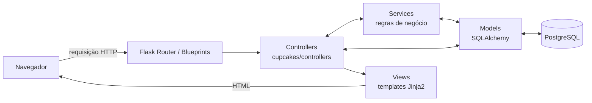

# Arquitetura e codificação

## Resumo para o formulário de entrega

| Campo | Resposta |
|---|---|
| Linguagem do back-end | Python 3 (framework Flask) |
| Banco de dados | PostgreSQL 17 (Supabase) |
| Hospedagem | Vercel |
| Plataforma | Web responsiva (computador e celular) |
| Modo de codificação | Tradicional |

## Padrão MVC



| Camada | Pasta | Responsabilidade |
|---|---|---|
| **Model** | `cupcakes/models/` | Tabelas, relacionamentos e validações de cada entidade (Cliente valida e-mail e senha, Cupcake valida preço e estoque) |
| **View** | `cupcakes/views/` + `public/static/` | Templates HTML (Jinja2), CSS e JavaScript. Só exibem dados; não acessam o banco |
| **Controller** | `cupcakes/controllers/` | Recebem a requisição, chamam models e services, escolhem a view e as mensagens |
| Services | `cupcakes/services/` | Regras que envolvem várias entidades: carrinho, cálculo de frete, pagamento e criação do pedido em uma transação |

Os erros de regra de negócio são lançados como `ErroNegocio` (`cupcakes/erros.py`) pelos models e services, e cada controller os transforma em mensagem para o usuário, sem deixar o sistema cair.

## Estrutura de pastas

```
pit2-loja-cupcakes/
├── app.py                     ponto de entrada (usado pela Vercel)
├── cupcakes/
│   ├── __init__.py            create_app: configura Flask, filtros, erros e CSRF
│   ├── config.py              configurações (produção e testes)
│   ├── extensions.py          instância do SQLAlchemy
│   ├── erros.py               ErroNegocio
│   ├── seguranca.py           sessão, login obrigatório, admin, CSRF
│   ├── seed.py                dados iniciais para o ambiente local
│   ├── models/                Categoria, Cupcake, Cliente, Pedido, ItemPedido, Pagamento, AvaliacaoTeste
│   ├── services/              carrinho, pagamentos, pedidos
│   ├── controllers/           loja, auth, carrinho, pedidos, admin, avaliacao
│   └── views/                 templates HTML por área
├── public/static/             CSS e JavaScript (servidos pela CDN da Vercel)
├── database/                  schema.sql e seed.sql
├── tests/                     testes Pytest
└── docs/                      documentação das 3 situações
```

## Rotas

| Método | Rota | Controller | Acesso |
|---|---|---|---|
| GET | `/` | loja.vitrine | público |
| GET | `/cupcake/<id>` | loja.detalhe | público |
| GET/POST | `/cadastro` | auth.cadastro | público |
| GET/POST | `/entrar` | auth.entrar | público |
| POST | `/sair` | auth.sair | logado |
| GET | `/carrinho/` | carrinho.ver | público |
| POST | `/carrinho/adicionar/<id>` | carrinho.adicionar | público |
| POST | `/carrinho/atualizar/<id>` | carrinho.atualizar | público |
| POST | `/carrinho/remover/<id>` | carrinho.remover | público |
| GET/POST | `/pedidos/finalizar` | pedidos.finalizar | logado |
| GET | `/pedidos/` | pedidos.lista | logado |
| GET | `/pedidos/<id>` | pedidos.detalhe | dono do pedido |
| POST | `/pedidos/<id>/cancelar` | pedidos.cancelar | dono do pedido |
| GET | `/admin/` | admin.pedidos | administrador |
| POST | `/admin/pedidos/<id>/avancar` | admin.avancar | administrador |
| POST | `/admin/pedidos/<id>/cancelar` | admin.cancelar | administrador |
| GET | `/admin/cupcakes` | admin.cupcakes | administrador |
| GET/POST | `/admin/cupcakes/novo` | admin.novo_cupcake | administrador |
| GET/POST | `/admin/cupcakes/<id>/editar` | admin.editar_cupcake | administrador |
| POST | `/admin/cupcakes/<id>/alternar` | admin.alternar_cupcake | administrador |
| GET | `/admin/avaliacoes` | admin.avaliacoes | administrador |
| GET/POST | `/avaliacao/` | avaliacao.formulario | público |

## Segurança e tratamento de erros

- Senhas com hash PBKDF2-SHA256 (600 mil iterações e sal aleatório).
- Token CSRF em todos os formulários POST; requisição sem token recebe a página 400.
- Sessão em cookie assinado, `HttpOnly`, `SameSite=Lax` e `Secure` em produção.
- Ao entrar, a sessão é recriada (evita fixação de sessão), mas o carrinho é preservado.
- Redirecionamento após login aceita só caminhos internos (evita open redirect).
- Cliente só vê e cancela os próprios pedidos (outro pedido responde 404).
- Pedido criado em transação com `SELECT ... FOR UPDATE` nos cupcakes, evitando vender mais do que o estoque quando duas pessoas compram ao mesmo tempo.
- Dados de cartão nunca são gravados; só os 4 últimos dígitos.
- Páginas próprias para 400, 403, 404 e 500. No erro 500 a transação é desfeita.
- No Supabase, RLS ligado em todas as tabelas: a API pública não expõe nenhum dado.

## Bibliotecas

| Biblioteca | Versão | Uso |
|---|---|---|
| Flask | 3.0.3 | framework web (rotas, sessões, templates) |
| Flask-SQLAlchemy | 3.1.1 | integração do ORM com o Flask |
| SQLAlchemy | 2.0.36 | ORM e geração do SQL |
| psycopg | 3.2.13 | driver do PostgreSQL |
| tzdata | 2024.2 | fuso horário de São Paulo nas datas |
| pytest | 8.3.3 | testes automatizados |
